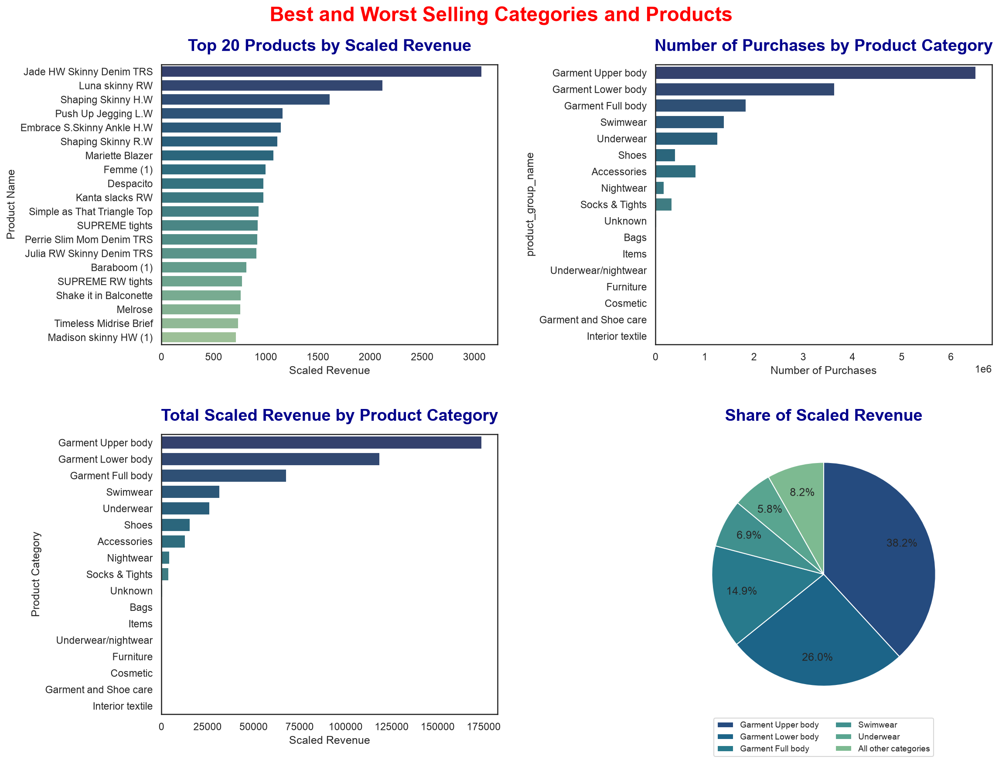
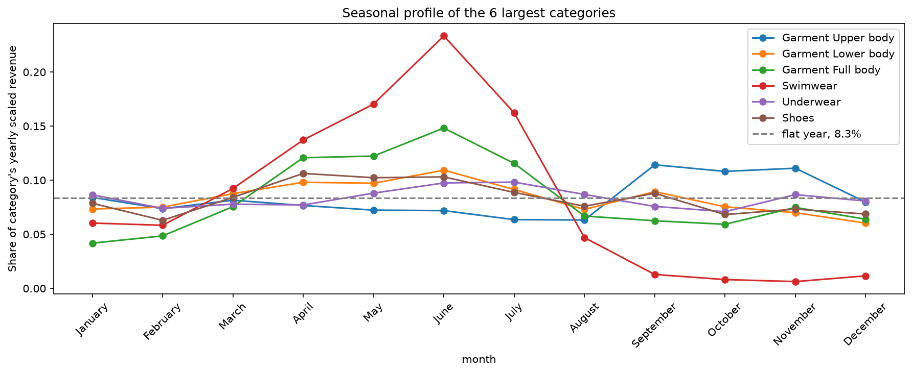
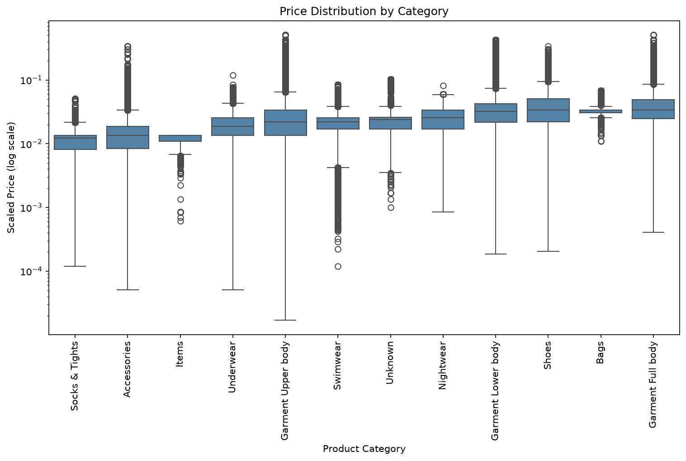
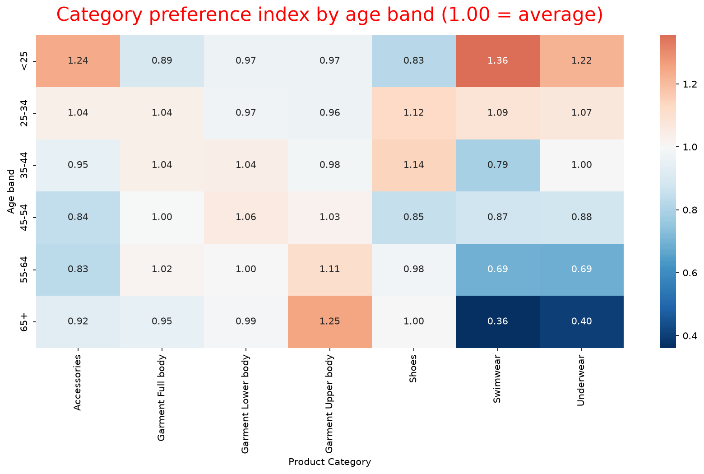
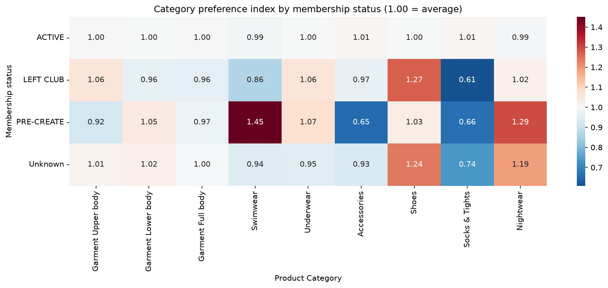
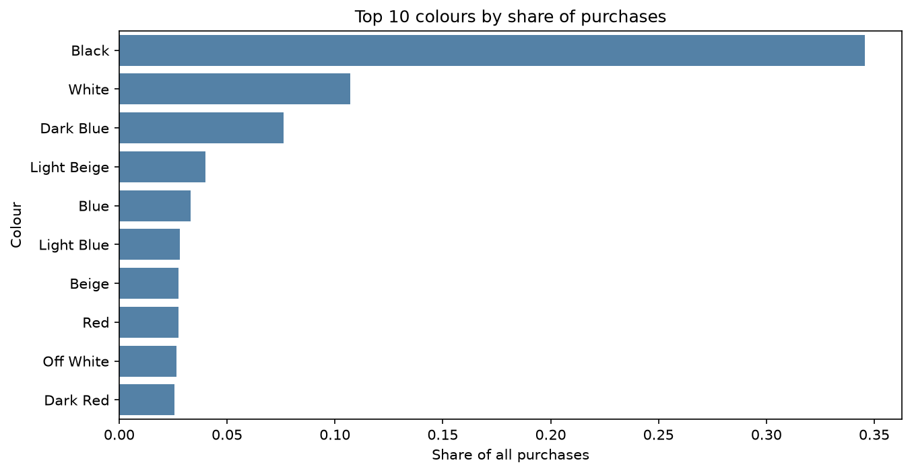

## Author

Built by Solace Asante
https://github.com/solace-asante

# H&M Fashion Retail Analysis (2019)

An end-to-end analysis of H&M purchase data from 2019, built with PostgreSQL, pandas and seaborn.

## Data

The data comes from the [H&M Personalized Fashion Recommendations dataset on Kaggle](https://www.kaggle.com/competitions/h-and-m-personalized-fashion-recommendations/data). The original file has about 31.8 million purchases. I use the 16,396,930 purchases made in 2019, the only complete calendar year. Each row is one purchase. Prices are scaled, so they are relative values and not real currency. The data is not stored in this repo. See How to reproduce.


## Business questions

I chose six questions myself to practise answering business questions with data. They are not from Kaggle or H&M.

Which categories and products sell best and worst? How do sales change through the year? How do prices differ inside each category? Do age groups prefer different categories? Does membership status change what customers buy? Which colours dominate?

## Tools

PostgreSQL, pandas, matplotlib and seaborn, in Jupyter notebooks.  

## Key findings

### 1. Best and worst selling categories and products

Garment Upper body leads in both purchases and scaled revenue, with 6.5M purchases and 38.2% of the total scaled revenue. Its lead is consistent with volume and not price, because its average price is lower than Garment Full body and Bags. Accessories has more purchases than Shoes, 816K against 400K, but Shoes earns more scaled revenue, 15.6K against 12.9K, and has the higher typical price. 12 of the top 20 products by scaled revenue are Garment Lower body. Cosmetic, Garment and Shoe care, and Interior textile earn the least scaled revenue, but they are small side categories. About 5.8% of products sold exactly once, so I did not rank the worst-selling products.

Notebook: `notebooks/02_best_selling.ipynb`



### 2. Monthly and seasonal patterns

Swimwear is the most strongly seasonal category. June holds 23.3% of its yearly scaled revenue. That is about 2.8 times an average month. From September to December it falls to near 1%. Garment Full body is moderately seasonal with a June peak of 14.8%. Garment Upper body is only mildly seasonal, with a September peak of 11.4%. Underwear is flat.

Notebook: `notebooks/03_seasonal_patterns.ipynb`



### 3. Pricing within category

Typical prices differ by category. Socks & Tights has the lowest median, about 0.012, while Shoes, Garment Full body and Bags are highest at about 0.034, with Garment Lower body just below. Garment Upper body has the most uneven prices of the large categories, with a variation of 0.80 and a long tail of expensive purchases. Items, Bags and Swimwear have narrow boxes, so most of their purchases cost about the same, but Swimwear also has many unusually cheap purchases. Categories with fewer than 1,000 purchases are not shown.

Notebook: `notebooks/04_price.ipynb`



### 4. Age and category preference

Garment Upper body is the top category in every age band, which fits it being the largest category overall. Its share of scaled revenue rises with age, from about 37% under 45 to 47.8% for 65+, a preference index of 1.25. Customers under 25 over-index on Swimwear, with an index of 1.36, the strongest in the table. The bands from 25 to 64 lean only slightly, with indexes between 1.06 and 1.14.

Notebook: `notebooks/05_age.ipynb`



### 5. Membership status

ACTIVE accounts for about 97.6% of purchases, so the small groups are less reliable. The median price is identical in all four groups, 0.025407. The mean is 6 to 9% higher in the three smaller groups than in ACTIVE. LEFT CLUB and Unknown over-buy Shoes, with indexes of 1.27 and 1.24, which is consistent with their higher means. PRE-CREATE over-buys Swimwear, with an index of 1.45. The status is a customer attribute and not necessarily the status at purchase time.

Notebook: `notebooks/06_membership.ipynb`



### 6. Colour

The data has 50 colour names. Black is the most common, with 34.6% of purchases, and it takes 13 colours to reach 80% of all purchases.

Notebook: `notebooks/07_color.ipynb`




## Repository structure

```
fashion-analytics/
├── data/
│   ├── raw/                 
│   └── processed/           
├── notebooks/                
├── reports/                
├── scripts/
│   └── extract_data.py     
├── sql/
│   └── schema.sql     
├── .gitignore
└── README.md
```

## How to reproduce

1. Download the dataset from Kaggle into `data/raw/`
2. Create the database with `sql/schema.sql` and load the raw files
3. Add a `.env` file with your database credentials
4. Run `python scripts/extract_data.py` to create `data/processed/hm_2019.csv`.
5. Run `notebooks/01_cleaning_data.ipynb` to create `merged_cleaned_2019.csv`.
6. Run the other notebooks in order

## Limitations

Prices are scaled, so no conclusion is stated in real currency. Only 2019 is covered, so the patterns come from a single year and can't be separated from one-off events. Each row is a purchase not a customer, so a customer who bought often is counted many times. 

Age and membership status are customer attributes not necessarily the values at the time of purchase. Price is per purchase, so the spread of prices inside a category mixes different products and possible discounts. The same product name can appear in more than one categor  which affects about 0.6% of product names.
